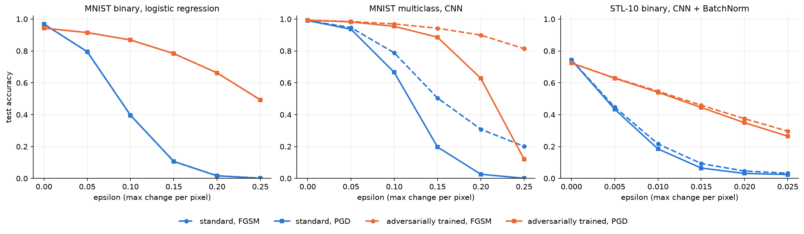

# Adversarial Robustness of Neural Networks

[](https://github.com/kathrynblur/adversarial-robustness/actions/workflows/ci.yml)

Neural networks can be fooled by tiny, carefully chosen changes to an input: an image that still looks
the same to a human gets a completely different prediction. This project studies these *adversarial examples*
on logistic regression, CNNs and a pretrained ResNet-18 (MNIST and STL-10). It compares the FGSM and PGD attacks,
L1/L2 regularization and adversarial training, and includes an interactive demo.

It grew out of my bachelor thesis, *A Theoretical and Empirical Study of Adversarial Vulnerabilities in Neural Networks*
(BSc Data Science, KU Eichstätt-Ingolstadt). After the thesis, I turned the research code into a tested Python package
with config-based experiments, experiment tracking, a REST API and a web demo.

**Live demo:** [https://huggingface.co/spaces/kathrynblur/adversarial-robustness](https://huggingface.co/spaces/kathrynblur/adversarial-robustness)

## Key findings



*Test accuracy as the attack strength epsilon grows. Dashed lines: FGSM, solid lines: PGD.
Blue: standard training, orange: adversarial training. In the left panel, FGSM and PGD give identical results,
so the dashed lines are hidden behind the solid ones.*

- **Small changes are enough.** Under PGD with epsilon = 0.15, the standard MNIST CNN drops from 99% to about 23% accuracy.
- **Adversarial training works, up to a limit.** At the same epsilon, the adversarially trained CNN keeps about 90%.
  Above the epsilon it was trained with, PGD breaks it too.
- **FGSM alone overstates robustness.** At epsilon = 0.25, FGSM reports 84% accuracy for the adversarially trained CNN,
  but PGD shows the true worst case: about 20%. Robustness should be evaluated with the stronger attack.
- **For a binary linear model, FGSM is already optimal.** For logistic regression, PGD gives exactly the same accuracy
  as FGSM, as the theory predicts.
- **Fixing a model that did not learn.** The original STL-10 cat-vs-dog CNN barely learned (63% test accuracy).
  With batch normalization, Adam and a smaller batch size, it reached 72.5%, and adversarial training then
  became effective as well (see `notebooks/03_stl10_binary_cnn_fix.ipynb`).

### All experiments

Accuracy on the test set, clean and under attack at the training epsilon of the adversarial models
(0.15 for MNIST, 0.015 for STL-10). PGD uses 10 steps.

| Experiment | Clean | epsilon | FGSM | PGD |
|---|---|---|---|---|
| `mnist_binary_cnn` | 99.7% | 0.15 | 66.8% | 55.0% |
| `mnist_binary_cnn_adv` | 99.9% | 0.15 | 97.7% | 95.5% |
| `mnist_binary_logreg` | 96.9% | 0.15 | 10.6% | 10.6% |
| `mnist_binary_logreg_adv` | 94.3% | 0.15 | 78.3% | 78.3% |
| `mnist_multiclass_cnn` | 99.1% | 0.15 | 50.4% | 19.7% |
| `mnist_multiclass_cnn_adv` | 99.3% | 0.15 | 94.2% | 88.6% |
| `stl10_binary_cnn_bn` | 74.4% | 0.015 | 9.3% | 6.5% |
| `stl10_binary_cnn_bn_adv` | 72.4% | 0.015 | 45.9% | 44.5% |
| `stl10_binary_resnet` | 83.1% | 0.015 | 14.1% | 0.0% |
| `stl10_multiclass_resnet` | 79.4% | 0.015 | 7.6% | 0.0% |

Every run, with its config, loss curves and robustness curves, is tracked in
[Weights & Biases](https://forge.coreweave.com/wandb/kathrynblur-ekaterina-jaynes/adversarial-robustness).

## Repository structure

```
├── src/advrobust/        the Python package
│   ├── models.py         logistic regression, CNNs, ResNet-18
│   ├── attacks.py        FGSM, PGD, Gaussian and random-sign noise baselines
│   ├── train.py          one training loop: L1/L2 regularization, adversarial training, augmentation
│   ├── evaluate.py       accuracy under attacks and noise
│   ├── data.py           MNIST and STL-10 loading, binary splits
│   ├── augment.py        data augmentation
│   ├── inference.py      prediction, attacks and robustness score for single images (API and demo)
│   └── cli.py            runs an experiment from a YAML config
├── configs/              one YAML file per experiment
├── notebooks/            thesis experiments, the STL-10 CNN fix, FGSM vs. PGD
├── results/              results.json for every experiment
├── tests/                pytest test suite
├── app/
│   ├── api.py            FastAPI service
│   ├── demo.py           Gradio demo
│   └── weights/          trained MNIST CNNs used by the API and the demo
├── scripts/              figure and results table for this README
├── Dockerfile
└── .github/workflows/    CI: ruff and pytest on every push
```

## Getting started

```bash
git clone https://github.com/kathrynblur/adversarial-robustness.git
cd adversarial-robustness
python -m venv .venv
source .venv/bin/activate
pip install -e ".[dev,serve]"
```

**Run the tests and the linter**

```bash
pytest
ruff check .
```

**Run experiments**

Each config trains one model, evaluates it under FGSM and PGD, and saves `results/<name>/results.json`:

```bash
advrobust configs/mnist_multiclass_cnn_adv.yaml
advrobust configs/*.yaml                      # all experiments
advrobust configs/*.yaml --tracking wandb     # with Weights & Biases tracking
python scripts/make_figures.py                # figure and table for this README
```

**Start the demo**

```bash
python app/demo.py
```

Then open http://127.0.0.1:7860, draw a digit and attack it.

**Start the API**

```bash
uvicorn app.api:app
```

Interactive documentation: http://127.0.0.1:8000/docs. The `/predict` endpoint takes an image and returns
the prediction, the prediction after an FGSM or PGD attack, and a robustness score
(the smallest PGD epsilon that changes the prediction).

**Run the API in Docker**

```bash
docker build -t advrobust .
docker run -p 8000:8000 advrobust
```

## Background

The original thesis code, which reproduces the results in the thesis, is in
[adversarial-examples-bachelor-thesis](https://github.com/kathrynblur/adversarial-examples-bachelor-thesis).
This repository builds on it, adds PGD and the engineering parts, and corrects the STL-10 binary CNN.


## License

MIT
